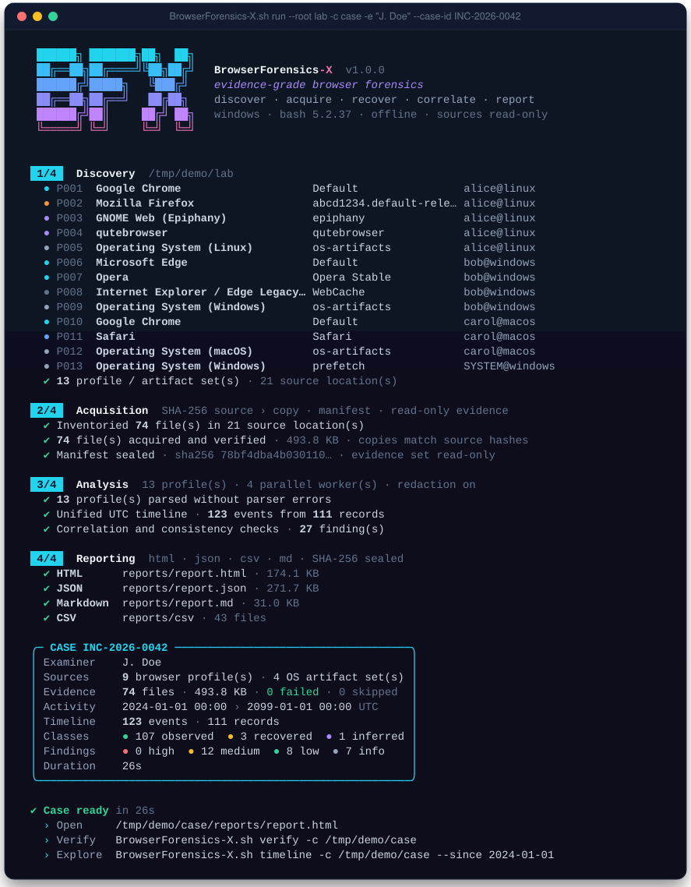
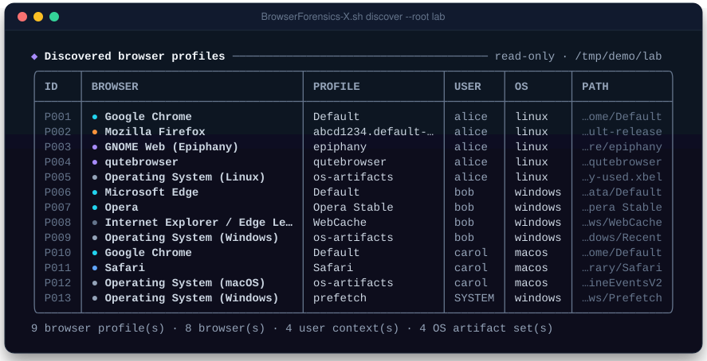
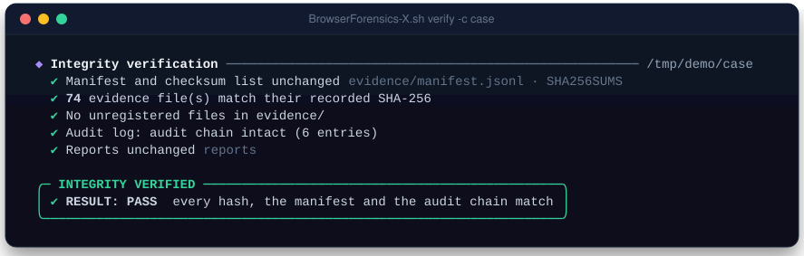
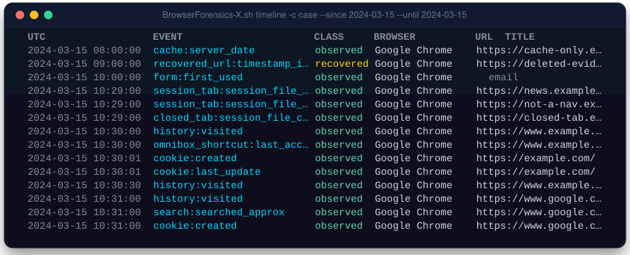
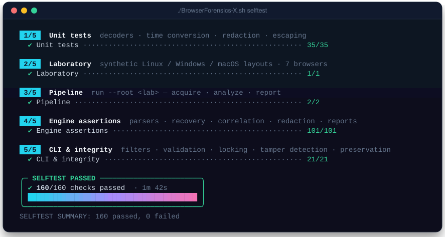
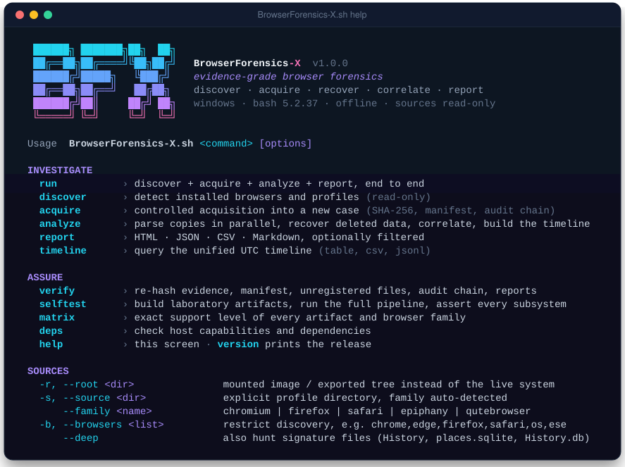
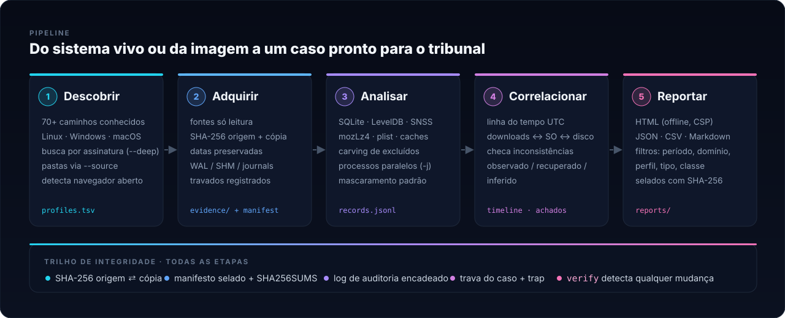
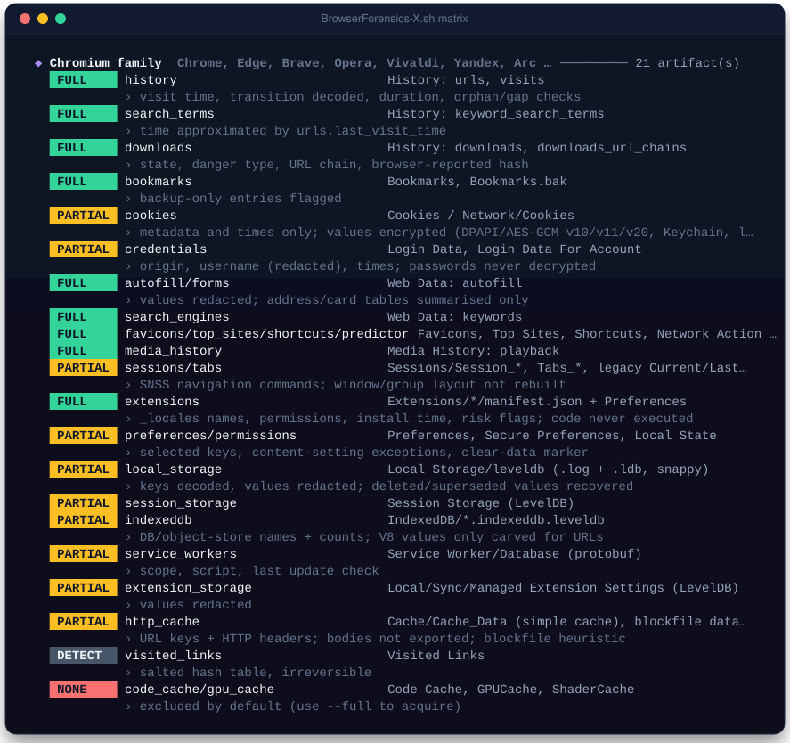

<div align="center">



<br>


<h3>
  <a href="#-quick-start">Quick start</a>
  <span>&nbsp;·&nbsp;</span>
  <a href="#-what-it-recovers">Coverage</a>
  <span>&nbsp;·&nbsp;</span>
  <a href="#-forensic-integrity">Integrity</a>
  <span>&nbsp;·&nbsp;</span>
  <a href="#-the-cli">CLI</a>
  <span>&nbsp;·&nbsp;</span>
  <a href="#-reference">Reference</a>
  <span>&nbsp;·&nbsp;</span>
  <a href="#-validation--limitations">Limitations</a>
</h3>

</div>

<br>

**BrowserForensics-X** finds every browser profile on a live system or a mounted image, makes a hashed copy
of each one, and parses those copies offline. It recovers deleted records, merges everything into one UTC
timeline, links browser activity to OS artifacts, and writes reports you can hand to someone else. All of it
ships as **one self-contained `BrowserForensics-X.sh`**.

Bash handles discovery, acquisition, hashing, the evidence manifest, the audit chain, parallel jobs and
verification. Formats that Bash cannot parse honestly (SQLite internals, LevelDB, SNSS, mozLz4, plists, cache
formats) go to a Python 3 engine that uses only the standard library. The engine is embedded in the same file
and is written to a private temp directory when the tool runs.

<table>
<tr>
<td width="33%" valign="top">

### 🧭 Finds everything
70+ known install layouts on Linux, Windows and macOS. That covers Chrome, Edge, Brave, Opera/GX, Vivaldi,
Yandex, Arc, Firefox/ESR, LibreWolf, Waterfox, Tor, Floorp, Zen, Safari, Epiphany, qutebrowser and IE/Edge
Legacy. Signature hunting (`--deep`) catches anything else.

</td>
<td width="33%" valign="top">

### 🔒 Touches nothing
Sources are only read. Every file gets a SHA-256 before and after copying. SQLite only ever opens
**disposable copies** of the hashed evidence. The audit log is hash-chained, and `verify` detects a single
changed byte.

</td>
<td width="33%" valign="top">

### 🧬 Recovers more
URLs are carved from SQLite freelists, freeblocks, unallocated space, WAL frames and rollback journals, with
record reconstruction. LevelDB entries that were deleted or superseded are recovered too. Every result is
labelled **observed**, **recovered** or **inferred**.

</td>
</tr>
</table>

<br>

## ⚡ Quick start

```bash
# 1. get the single file
chmod +x BrowserForensics-X.sh

# 2. check the host (bash, hashing, python engine)
./BrowserForensics-X.sh deps

# 3. prove the tool on its own laboratory (≈ 2 min, 160 checks)
./BrowserForensics-X.sh selftest

# 4. triage this machine into a new case
./BrowserForensics-X.sh run -c ./cases/HOST01 -e "J. Doe" --case-id INC-2026-0042
```

> [!TIP]
> Close the browsers before a live acquisition. On Windows, files locked by a running browser can't be copied
> without VSS. They are **recorded as failed, never silently skipped**, and the case is marked *partial*
> (exit code `5`).

<br>

## 🖥️ The CLI

The terminal UI picks up truecolor, 256 or 16 colours and falls back to plain output. It renders Unicode or
plain ASCII, adapts to the terminal width, and makes report paths clickable (OSC 8) where the terminal supports
it. All UI chrome is written to **stderr**, so `stdout` stays clean for pipes (`timeline --format csv | …`).
When output is redirected the tool goes plain on its own, and it respects `NO_COLOR` and `--no-color`.

<div align="center">

<sub>A full <code>run</code> on the bundled synthetic laboratory: 4 steps, gradient progress bars, and a sealed case summary.</sub>
</div>

<br>

<table>
<tr>
<td width="50%"><br><sub><code>discover</code> is read-only: every profile, user and layout it finds.</sub></td>
<td width="50%"><br><sub><code>verify</code> re-hashes evidence, checks the manifest, looks for unregistered files, and validates the audit chain and reports.</sub></td>
</tr>
<tr>
<td width="50%"><br><sub><code>timeline</code> is one UTC timeline across browsers, coloured by evidence class.</sub></td>
<td width="50%"><br><sub><code>selftest</code> builds a lab, runs the whole pipeline and asserts 160 checks.</sub></td>
</tr>
</table>

<details>
<summary><b>Full help screen</b></summary>
<br>

</details>

<br>

## 🛰️ Pipeline



| Step | What happens | Output |
|---|---|---|
| **Discover** | Known per-OS paths, `profiles.ini` custom paths, Opera single-profile layouts, external cache dirs, OS artifacts; `--deep` signature hunt; `--source` for exported folders | `profiles.tsv`, `sources.tsv` |
| **Acquire** | Hash the source, copy with timestamps preserved (WAL/SHM/journals included), hash the copy, then seal the manifest. Symlinks, oversize and locked files are **recorded**, never silently dropped | `evidence/`, `manifest.jsonl`, `SHA256SUMS` |
| **Analyze** | One parallel worker per profile. Parser failures are isolated, so one broken database can't sink the case | `analysis/<id>/records.jsonl` |
| **Correlate** | Timeline merge; downloads ↔ LNK / xbel / Quarantine ↔ the file on disk (size, SHA-256, Zone.Identifier); cache/favicons/tabs without history; future timestamps | `timeline.jsonl`, `findings.json` |
| **Report** | HTML (offline, CSP-locked, all content escaped), JSON, CSV (formula-injection safe), Markdown — then SHA-256 sealed | `reports/` |

<br>

## 🧬 What it recovers

<table>
<tr><th align="left">Family</th><th align="left">Artifacts</th></tr>
<tr><td><b>Chromium</b><br><sub>Chrome · Edge · Brave · Opera · Vivaldi · Yandex · Arc · Thorium · …</sub></td>
<td>history &amp; visits (transition, duration) · search terms · downloads + URL chain + browser hash · bookmarks (+ backup-only) · cookies (metadata) · stored logins (inventory) · autofill · search engines · favicons · top sites · omnibox shortcuts &amp; predictor · media history · <b>SNSS sessions</b> · extensions + risk flags · preferences, permissions, "clear browsing data" marker · <b>Local/Session Storage (LevelDB + snappy)</b> · IndexedDB names · service workers · extension storage · HTTP cache (simple &amp; blockfile)</td></tr>
<tr><td><b>Gecko</b><br><sub>Firefox · ESR · LibreWolf · Waterfox · Tor · Floorp · Zen · …</sub></td>
<td>history &amp; visit types · bookmarks · downloads · input history · page-interaction metadata · cookies · form history <b>+ deletion tombstones</b> · logins (inventory) · favicons · <b>mozLz4 sessions</b> (open/closed tabs &amp; windows) · add-ons + signing state · prefs incl. anti-forensic settings · permissions · LSNG &amp; legacy localStorage · IndexedDB · service workers · cache2</td></tr>
<tr><td><b>Safari / WebKit</b></td>
<td>History.db <b>+ history tombstones</b> · Downloads.plist · bookmarks &amp; Reading List · last session &amp; recently closed tabs · iCloud tabs · top sites · <b>binarycookies</b> · Cache.db · LocalStorage · favicons · per-site permissions · extensions</td></tr>
<tr><td><b>Others</b></td><td>GNOME Web (Epiphany) · qutebrowser · IE / Edge Legacy <code>WebCacheV01.dat</code> (detected &amp; hashed)</td></tr>
<tr><td><b>OS correlation</b></td><td>Linux <code>recently-used.xbel</code> · macOS <code>QuarantineEventsV2</code> · Windows Recent <code>.lnk</code> · Prefetch (browser executables) · downloaded file on disk</td></tr>
<tr><td><b>Recovery</b></td><td>SQLite freelist / freeblocks / unallocated gaps / WAL frames (current &amp; stale) / rollback journals with record reconstruction and noise rejection · LevelDB deleted &amp; superseded values</td></tr>
</table>

Each artifact has a declared support level. Print the authoritative list with `./BrowserForensics-X.sh matrix`:

| Level | Meaning |
|---|---|
|  | structured parse of the documented fields |
|  | structured, but some fields/structures are not decoded |
|  | recovery by carving — no completeness guarantee |
|  | acquired, hashed and inventoried only |
|  | not supported |

<details>
<summary><b>Preview of <code>matrix</code></b></summary>
<br>

</details>

<br>

## 🔐 Forensic integrity

```text
cases/INC-2026-0042/
├── case.json              case metadata, environment, options, limitations
├── audit.log              hash-chained: every line seals the previous one
├── profiles.tsv           what was discovered, and how
├── sources.tsv            exactly which locations were acquired
├── support_matrix.tsv     the support levels in force for this case
├── errors.jsonl           every acquisition / analysis problem, never hidden
├── evidence/              read-only after sealing
│   ├── manifest.jsonl     source, copy, size, m/a/ctime, SHA-256 source + copy, status
│   ├── SHA256SUMS         coreutils-compatible
│   ├── manifest.sha256    seals manifest + SHA256SUMS
│   └── P001/profile/…     byte-identical copies
├── analysis/              records, inventories, timeline, findings, correlations
├── reports/               report.html · report.json · report.md · csv/ · SHA256SUMS
└── logs/
```

**Guarantees**

- **Sources are read, never written.** The tool never opens a source with SQLite. WAL is applied only inside
  throw-away working copies of the evidence copies, and those are deleted afterwards (`--keep-work` keeps them).
- **Hash on both sides.** If a source changes mid-copy, it is detected and labelled
  `source-changed-during-acquisition`.
- **Tamper-evident.** `verify` re-hashes every copy and fails on unregistered files, a modified manifest, a
  broken audit chain or altered reports (exit code `4`).
- **Evidence is never executed.** Extension code, scripts and downloaded binaries are treated as bytes. XML
  parsing rejects `DOCTYPE`/`ENTITY` (XXE). The HTML report runs under a strict nonce CSP, loads no external
  resources and never makes URLs clickable.
- **Secrets are redacted by default.** Cookie and storage values, form data, usernames, e-mails and sensitive
  URL parameters (`token=`, `session=` …) are replaced by `[REDACTED len=N hmac=…]`. The HMAC is keyed per
  case, so the examiner can verify a known value while report readers cannot brute-force it. `--no-redact`
  is explicit, logged and audited.
- **Encryption is respected.** Chromium cookie values and passwords (DPAPI / v10 / v11 / v20 / Keychain /
  libsecret), Firefox `logins.json` (NSS) and the Keychain are **inventoried, never decrypted**.
- **No network, ever.** No lookups, no telemetry, no update checks.

<br>

## 🧠 Evidence classes & findings

| Class | Meaning | Examples |
|---|---|---|
|  | read from a live record | visits, cookies, bookmarks, SNSS navigations |
|  | rebuilt from deleted / superseded data | freeblock URLs with titles and timestamps, stale WAL pages, deleted LevelDB values |
|  | derived by correlation or heuristics | Prefetch execution time, cache-without-history, visit-ID gaps |

Built-in checks raise **findings** with a severity. They cover:

- orphan visits and visit-ID gaps;
- "clear browsing data" markers and anti-forensic settings (clear on shutdown, permanent private mode);
- Safari history and Firefox form-history tombstones;
- dangerous, missing, resized or modified downloads;
- sideloaded or unsigned extensions with broad permissions;
- uncheckpointed WAL data, hot journals and SQLite corruption;
- timestamps in the future or later than file mtimes;
- cached pages, favicons or tabs with no matching history.

<br>

## 📚 Reference

<details open>
<summary><b>Commands</b></summary>

| Command | Purpose |
|---|---|
| `run` | discover → acquire → analyze → report, end to end |
| `discover` | detect browsers & profiles (read-only); `--format tsv` for scripts |
| `acquire` | controlled acquisition into a **new/empty** case directory |
| `analyze` | parse, recover, correlate, build the timeline (parallel) |
| `report` | HTML · JSON · CSV · Markdown, optionally filtered |
| `timeline` | query the timeline as `table`, `csv` or `jsonl` |
| `verify` | full integrity verification of a case |
| `selftest` | laboratory build + pipeline + 160 assertions |
| `matrix` | support level of every artifact |
| `deps` | host capabilities and dependencies |

</details>

<details>
<summary><b>Options</b></summary>

| Option | Description |
|---|---|
| `-r, --root DIR` | mounted image / exported tree instead of the live system (repeatable) |
| `-s, --source DIR` | explicit profile directory, family auto-detected (repeatable) |
| `--family F` | force the `--source` family: `chromium` `firefox` `safari` `epiphany` `qutebrowser` |
| `-b, --browsers LIST` | restrict discovery, e.g. `chrome,edge,firefox,safari,os,ese` |
| `--deep` / `--depth N` | signature hunting (default depth 8) |
| `--no-os-artifacts` | skip xbel / LNK / Prefetch / QuarantineEventsV2 |
| `-c, --case DIR` | case directory |
| `--case-id ID`, `-e, --examiner NAME`, `--notes TEXT` | case metadata |
| `--no-cache` / `--full` | skip HTTP caches / include JIT & GPU caches |
| `--max-file-size SIZE` | skip (but record) larger files — default `2G` |
| `-j, --jobs N` | parallel analyses (default CPUs, max 8) |
| `--no-redact` | **disable** redaction (audited) |
| `--no-recover` | skip deleted-record carving |
| `--no-fs-correlation` | don't stat/hash downloaded files under the root |
| `--keep-work` | keep SQLite working copies |
| `--since`, `--until` | ISO-8601; UTC unless an offset is given; a bare date covers the whole day |
| `--domain LIST` | domain + subdomains; `~text` for substring |
| `--profile REGEX`, `--browser LIST`, `--type LIST`, `--class LIST` | report/timeline filters |
| `--formats LIST`, `-o, --out DIR` | report formats and destination |
| `--format`, `--limit` | timeline / discover output |
| `-v`, `-q`, `--no-color`, `--keep-tmp` | verbosity and output |

Environment: `NO_COLOR=1`, `BFX_ASCII=1` (ASCII glyphs), `BFX_PYTHON=/path/python3`,
`BFX_COLOR_DEPTH=0|4|8|24`, `BFX_NO_BANNER=1`.

</details>

<details>
<summary><b>Recipes</b></summary>

```bash
# mounted Windows image, Chromium browsers + OS artifacts, 4 workers
./BrowserForensics-X.sh run -r /mnt/evidence/C -c ./cases/IMG01 -b chrome,edge,brave,os -j 4

# a single exported profile folder
./BrowserForensics-X.sh run -s ./export/Default -c ./cases/EXP01

# acquire on the suspect host (no Python needed), analyze on the lab workstation
./BrowserForensics-X.sh acquire -c /media/usb/CASE01
./BrowserForensics-X.sh analyze -c /media/usb/CASE01 && ./BrowserForensics-X.sh report -c /media/usb/CASE01

# one day, one domain, as CSV for a spreadsheet
./BrowserForensics-X.sh timeline -c ./cases/IMG01 --since 2024-03-15 --until 2024-03-15 \
    --domain example.com --format csv > day.csv

# only recovered evidence and downloads, HTML + CSV
./BrowserForensics-X.sh report -c ./cases/IMG01 --type download,recovered_url --formats html,csv

# before hand-over
./BrowserForensics-X.sh verify -c ./cases/IMG01
```

</details>

<details>
<summary><b>Exit codes</b></summary>

| Code | Meaning |
|---|---|
| `0` | success |
| `1` | error |
| `2` | usage / validation error |
| `3` | missing dependency (e.g. Python for `analyze`) |
| `4` | integrity failure (`verify`) |
| `5` | completed with partial results (locked files, parser errors) |

</details>

<details>
<summary><b>Requirements & platforms</b></summary>

| | Required | Notes |
|---|---|---|
| **Bash** | ≥ 4.4 | macOS ships 3.2 → `brew install bash` |
| **coreutils** | `find cp sha256sum`/`shasum`/`openssl`, `stat`, `xargs` … | GNU tools batch faster; BSD fallbacks included |
| **Python** | ≥ 3.8, stdlib only | needed for `analyze`/`report`/`timeline`/`selftest`; **not** for `discover`/`acquire`/`verify` |
| `sqlite3`, `jq` | not needed | |

**Linux** is native. **Windows** runs under Git Bash / MSYS2 / Cygwin / WSL; WSL also scans `/mnt/c/Users`.
**macOS** needs Full Disk Access for the terminal to read Safari data (unreadable files show up as errors).

</details>

<br>

## 🧪 Validation & limitations

This tool is built to say exactly what it did and did not do.

- **Self-test (160 checks).** Every parser runs on synthetic artifacts that follow each browser's schema, in
  Linux, Windows and macOS layouts. The checks cover:
  - decoders (snappy, LZ4, CRC32C, varints, protobuf, SNSS pickles, binarycookies, LNK) and UTC conversion for
    7 timestamp epochs;
  - deleted-record recovery and the noise filter;
  - redaction (15 planted secrets must never appear in any output) and HTML escaping of hostile titles;
  - CLI validation, case locking, and tamper detection on evidence and the audit log;
  - acquisition without Python, and preservation of the lab sources (content and mtime).
- **Validated on real-browser output.** Profiles produced by real **Chrome and Edge** (Windows): history and
  transitions, cookies, SNSS sessions, localStorage, blockfile cache, service workers and IndexedDB names.
- **Not yet validated on real-browser output.** Firefox, Safari, Epiphany, qutebrowser, the Chromium
  simple-cache format and IndexedDB record counts. They are covered only by the synthetic lab. Schema drift
  is handled column by column and reported as a parser error, never silently.
- **Not supported.**
  - The ESE `WebCacheV01.dat` and Prefetch content (MAM) are not decoded. Both are acquired and hashed, and
    Prefetch file times are used as an *inferred* signal.
  - Secrets are not decrypted, by design.
  - Window/tab-group layout is not rebuilt from SNSS, and Safari `SessionState` blobs are not decoded.
  - V8 / structured-clone IndexedDB values are carved for URLs only.
- **Carving gives no completeness guarantee.** Data overwritten by `secure_delete`, `VACUUM` or LevelDB
  compaction is gone.
- **Live Windows acquisition does not use VSS.** Close the browsers, or acquire from an image or snapshot.

<br>

<div align="center">

<sub>Built for examiners who have to explain every byte.<br>
<b>BrowserForensics-X</b> · discover · acquire · recover · correlate · report</sub>

</div>
